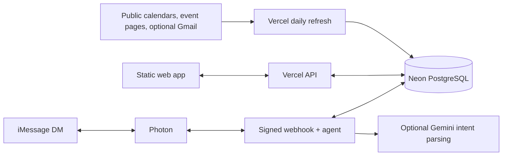

# WTM

**Find a free event. Make it a group plan.**

WTM is an event discovery and planning app built by [Aiden Ko](https://github.com/aaidenko) for a small Stanford friend group. It brings campus calendars, Bay Area events and newsletter links into one daily feed, with shared saves, attendance and an optional iMessage agent.

[Live app](https://wtm-rn.vercel.app) · [Setup guide](docs/setup.md) · [Security and privacy](SECURITY.md)

The live instance is invite-only. The source can be explored without access to the group or its database. WTM is independent of Stanford University.

## What it does

- **Discover:** the next 30 days of events, filtered for confirmed free admission and Stanford student eligibility. Match startups, trading, CS, AI, research, food and drinks.
- **Browse:** compact list, cards and calendar views; sort by date or relevant tags; separate campus and SF feeds.
- **Plan together:** star events into Your Moves, add friend plans and see who is attending a saved event.
- **Add sources:** group members can add supported public calendars or Luma pages; new sources scan immediately and join the daily refresh.
- **Read announcements:** an optional dedicated Gmail inbox supplies direct Luma event links without showing emails in the app.
- **Text WTM:** an optional Photon DM agent finds events, saves plans and updates attendance. Gemini interprets casual prompts; basic commands also work without a model key.

## Architecture

The browser renders a static JavaScript app. Vercel Node functions handle shared data and daily ingestion; Neon stores event snapshots, friend plans and group state. No always-on personal computer is needed.



| Layer | Implementation |
| --- | --- |
| Interface | HTML, CSS, JavaScript ES modules |
| Hosting and functions | Vercel Hobby, Node.js 22 |
| Persistence | Neon PostgreSQL, parameterized queries |
| Ingestion | Stanford Events API, iCalendar, public event pages, optional Gmail IMAP |
| Messaging | Photon cloud DMs, verified webhook signatures |
| Natural language | Gemini free tier, structured intents, bounded actions |
| Verification | Node's built-in test runner |

## Engineering decisions

**Check admission before displaying an event.** Missing prices and free food do not establish free entry. Public ticket and audience metadata must support admission and eligibility; ambiguous events stay hidden. Organizer approval requirements remain visible.

**Refresh centrally and reuse public metadata.** One daily job scans sources into a shared snapshot. Admission checks cache for up to 72 hours for distant events and 20 hours near the event. Failed sources retain their last successful data with a warning. Saves and attendance are read from the database separately.

**Keep agent actions small.** The messaging agent uses a limited set of validated actions rather than arbitrary code execution. One-use pairing codes connect a phone to a browser identity. Message IDs deduplicate jobs, mutations and replies are stored together, and linked senders have a request limit.

**Use free services deliberately.** The deployed app uses free plans; optional integrations have quotas and may stop at their limits. There is no paid model fallback. Enable only the services needed for your own instance and keep Google billing disabled when using its free tier.

## Run locally

Requires Node.js 22.

```sh
npm ci
npm test
npm run build
```

To preview the static interface:

```sh
npm run demo
python3 -m http.server 3000 --directory public
```

Open `http://localhost:3000/?preview=1`. Preview mode keeps friend plans and calendar settings in your browser; it does not connect to the production database or run server integrations. `npm run demo` generates four clearly labeled fictional events with future dates. The generated `public/preview-data.json` is ignored and excluded from builds; no live group data is included.

For a working shared instance, follow the [deployment and integration guide](docs/setup.md). Copy `.env.example` for variable names, then configure your own credentials in Vercel. Do not use the live group's access code, inbox or database.

## Project map

- `public/` — browser views, event model, eligibility rules and agent pairing UI.
- `api/` — authenticated group API, scheduled refresh and Photon webhook entry point.
- `lib/` — source importers, admission cache, group identity and messaging actions.
- `tests/` — admission, source parsing, dates, authentication, pairing and agent behavior.
- `scripts/build.mjs` — static build that excludes preview data.
- `vercel.json` — routes, security headers, function limits and daily schedule.

## Boundaries

WTM is built for a trusted group, with a shared invite code and self-reported names, not verified Stanford accounts. Group members can manage shared calendars and remove friend plans. It does not scan private Partiful accounts, guarantee host approval, or discover every event. Newsletter signups and confirmations are handled separately; email ingestion currently extracts direct Luma links. See [security and privacy](SECURITY.md) before adapting this for a wider audience.
